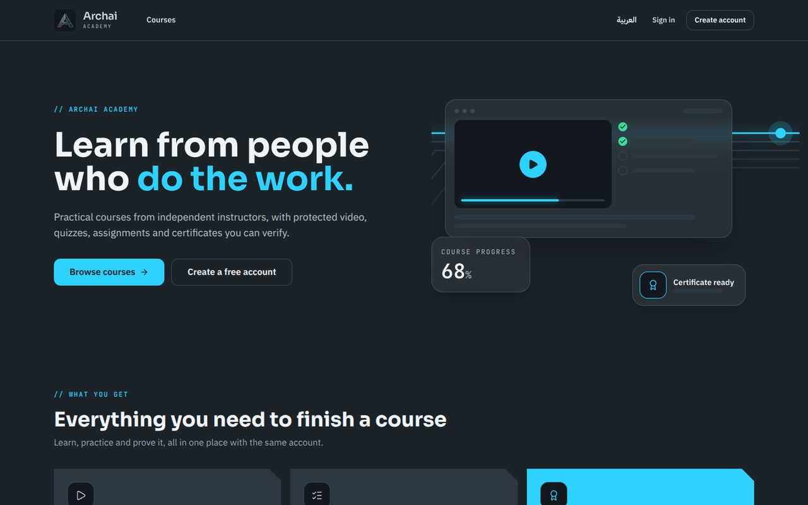

# Archai Academy — Secure Multi-Instructor LMS Marketplace

A production-oriented learning platform where independent instructors build and publish courses, and students learn from protected video, quizzes, assignments and verifiable certificates. A Super Admin owns the platform. **Payments are deliberately not enabled (phase 2)**, but the schema and interfaces are payment-ready.

| Layer | Choice |
|---|---|
| App | Next.js 15 (App Router) · React 19 · TypeScript · Tailwind CSS 3 · shadcn-style components |
| Backend | Next.js Route Handlers + Server Actions (Node runtime), modular `src/lib` services |
| Data & auth | Supabase PostgreSQL, Supabase Auth (incl. TOTP MFA), Row Level Security |
| Video & files | **Cloudflare R2** (private bucket, presigned URLs) — replaces Cloudflare Stream to stay near-free |
| Hosting | Vercel (preview + production) |
| Tests | Vitest + React Testing Library + PGlite (real Postgres engine) + Playwright |

Arabic (RTL) and English (LTR) are first-class, and the whole UI follows the **Archai Design System v2.0** (tokens, fonts, motifs, light-theme documents). See [`docs/`](docs): DESIGN, SPEC_COVERAGE, ARCHITECTURE, SECURITY, OPERATIONS, TESTING.




### Learning experience
Course page with *what you'll learn*, requirements, audience, accordion curriculum with durations, rating breakdown and a sticky purchase card · catalog with sidebar filters, sorting and active-filter chips · player with resume, keyboard shortcuts, autoplay-next, private timestamped **notes**, per-lesson **Q&A** with the instructor, **announcements**, downloads · dashboard with "pick up where you left off" · verifiable certificates (printable light theme).

> **Read this first — what R2 changes.** R2 is object storage, not a video platform. There is no transcoding, adaptive bitrate or HLS. Videos are streamed as progressive MP4/WebM through **short-lived signed URLs** (default 15 min, re-issued and re-authorized automatically while watching). Ask instructors to upload web-optimised H.264/AAC MP4 with "fast start". A signed URL is a bearer link for its lifetime, so this is *access control*, **not DRM** and cannot stop screen recording. Details in [`docs/SECURITY.md`](docs/SECURITY.md).

---

## 1. Prerequisites

- Node.js ≥ 20.9 (22 recommended, see `.nvmrc`) and npm
- A free [Supabase](https://supabase.com) project
- A free [Cloudflare](https://dash.cloudflare.com) account with R2 enabled (R2 requires a payment method on file, but the free tier — 10 GB storage, 1M Class A / 10M Class B ops per month, **zero egress fees** — covers an initial launch)

## 2. Supabase setup

1. Create a project. Copy **Project URL**, **anon key** and **service_role key** (Settings → API).
2. Apply the migrations **in order** — either:
   - paste `supabase/migrations/0001…0006_*.sql` into the SQL editor one after another, **or**
   - `npx supabase init && npx supabase link --project-ref <ref> && npx supabase db push`
3. Already applied 0001–0005 from an earlier delivery? Run **only** `0006_learning_experience.sql` (it adds Q&A, notes, announcements, the landing-page fields and the new catalog view).
3. Optional sample categories: run `supabase/seed.sql`.
4. Authentication → **URL Configuration**: Site URL = your site (`http://localhost:3000` locally); add Redirect URLs `http://localhost:3000/auth/callback` and your production `https://YOUR-DOMAIN/auth/callback`.
5. Authentication → Providers → Email: keep *Confirm email* on. Authentication → Multi-Factor: ensure **TOTP** is enabled (default).
6. Production: configure a **custom SMTP** provider (the built-in mailer is heavily rate limited) and set a minimum password length of 10+.

## 3. Cloudflare R2 setup

1. R2 → Create bucket (e.g. `lms-private`). **Keep it private** — do not enable the public `r2.dev` URL or a public custom domain.
2. R2 → Manage API tokens → create a token with **Object Read & Write**, scoped to *this bucket only*. Copy the Access Key ID, Secret Access Key and your Account ID.
3. Bucket → Settings → **CORS policy**: paste `r2-cors.json` and replace `YOUR-PRODUCTION-DOMAIN` (browsers upload directly to R2 with `PUT`).
4. (Recommended) Billing → Notifications: set usage/spend alerts.

## 4. Configure and run

```bash
npm install
cp .env.example .env.local        # fill in the values (never commit this file)
npm run dev                       # http://localhost:3000
```

Generate the two random secrets with `openssl rand -hex 32` (`PLAYBACK_HMAC_SECRET`) and `openssl rand -hex 24` (`CRON_SECRET`).

### Create the Super Admin (once)

```bash
npm run bootstrap:admin -- you@example.com "Your Name"
```

It prints a one-time password. Sign in at `/login`; you will be sent to **/account/security** to enrol an authenticator app. Admin screens stay locked until MFA is verified (enforced in the UI *and* inside Postgres RLS). Then:

1. **Admin → Categories** (or run `seed.sql`).
2. **Admin → Instructors → Create instructor** (shows a one-time password; the instructor can reset it via "Forgot password").
3. Instructor: create a course → add sections/lessons → upload videos → *Submit for review*.
4. Admin: **Courses → Approve & publish**. Students can now browse and enroll (free courses). Paid courses show a clearly labelled checkout placeholder.

> Local development tip: if you need to bypass admin MFA temporarily, run `update platform_settings set value='false' where key='require_admin_mfa';` — never in production.

### Troubleshooting sign-in / sign-up

| Symptom | Fix |
|---|---|
| `Could not find the function public.rate_limit_hit … in the schema cache` | Run `supabase/tools/diagnose.sql`. If a function is missing, apply the migrations (all six, in order). Then run `notify pgrst, 'reload schema';`. (The app now keeps sign-in working while the limiter is briefly unavailable.) |
| Login succeeds but you bounce back to `/login` | The auth user has no `profiles` row (created before migrations). The app now self-heals this; you can also run `supabase/tools/repair_and_promote_admin.sql`. |
| Register "works" but no e-mail arrives | Supabase's built-in mailer only sends to a few team addresses. For local testing turn off *Confirm email* (Auth → Providers → Email) or create users in Authentication → Users with *Auto Confirm User*. Configure custom SMTP for production. |
| `npm run bootstrap:admin` | Reads `BOOTSTRAP_SUPER_ADMIN_EMAIL/PASSWORD/NAME` from `.env.local`; add `--reset-password` to set the password on an existing user. |
| Language | The language switch is the button in the header (cookie-based); there are no `/ar` URLs. |
| `EBADENGINE` warnings | Harmless (test tooling wants Node ≥ 22.22.2). |

## 5. Scripts

| Command | Purpose |
|---|---|
| `npm run dev` / `build` / `start` | Next.js |
| `npm run check` | typecheck + lint + all Vitest suites |
| `npm test` | unit, component and **database/RLS** tests (PGlite, no services needed) |
| `npm run test:e2e` | Playwright HTTP/security tests against a running build (see `docs/TESTING.md`) |
| `npm run bootstrap:admin` | Create the first Super Admin |
| `npm run watermark:resolve -- ID-XXXXXXXXXX` | Map a leaked watermark back to an account |

## 6. Deploy (Vercel)

Import the GitHub repo, set the environment variables from `.env.example` (Production + Preview), set `NEXT_PUBLIC_SITE_URL` to the real URL, and add that URL to Supabase redirect URLs and the R2 CORS policy. `vercel.json` registers a daily cron for `/api/cron/maintenance` (Vercel passes `CRON_SECRET` automatically). Full checklist: [`docs/OPERATIONS.md`](docs/OPERATIONS.md).

> Vercel's free *Hobby* plan is for non-commercial use. Plan to move to Pro before you charge money (phase 2).

## 7. Project layout

```
supabase/migrations/   0001 schema · 0002 functions/triggers/views · 0003 grants+RLS · 0004 config seed · 0005 admin helpers · 0006 learning experience (Q&A, notes, announcements, landing fields, catalog view)
src/app/               routes (public, learn, instructor, admin, api)
src/actions/           server actions (auth, instructor, learning, admin)
src/lib/               auth, api wrapper, media (upload/playback), r2, rate-limit, audit, i18n, validation, payments contract
src/components/        UI primitives, player, uploader, quiz, MFA
tests/                 unit · db (RLS) · e2e (HTTP security)
scripts/               bootstrap-super-admin, resolve-watermark
docs/                  ARCHITECTURE · SECURITY · OPERATIONS · TESTING
```

## 8. Status and known limitations (honest summary)

**Implemented & verified here:** all 6 migrations apply cleanly; 89 Vitest tests (database/RLS on a real Postgres engine, a static guard that every Supabase query references real columns, unit and component tests); 22 HTTP security tests against the production build; `tsc`, ESLint and `next build` pass; the production build loads in headless Chromium under the strict CSP with zero console errors; axe-core reports 0 violations on the audited pages in English and Arabic. The full requirement-by-requirement audit is in [`docs/SPEC_COVERAGE.md`](docs/SPEC_COVERAGE.md).

**Not verified here (no live credentials / browser in the build sandbox):** end-to-end runs against a real Supabase project and a real R2 bucket (signup e-mails, MFA enrolment UI, direct browser upload, actual video playback), and manual screen-reader/mobile-device testing. Follow the manual checklist in `docs/TESTING.md` on staging before launch.

**By design / deferred:** no payment processing (phase 2: provider, webhooks, subscriptions, refunds, commissions, payouts — tables and contracts exist); bundles, memberships and subscriptions are modelled in the schema but have no UI; no co-instructor management UI (table exists); support/ticketing workflow not built (review moderation exists); course covers are generated gradients (no image uploads); video duration is client-reported (R2 cannot probe media); no transcoding/HLS; no DRM; `npm audit` still reports a PostCSS advisory inside Next's bundled build tooling (build-time only, fix requires a Next major upgrade).
